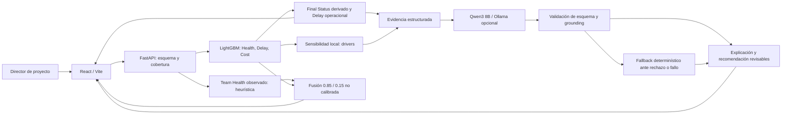
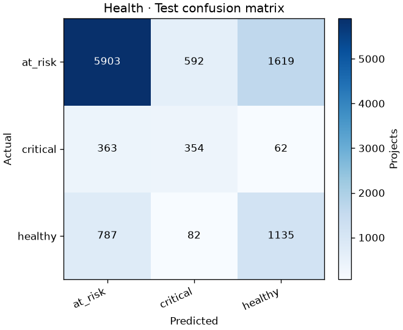
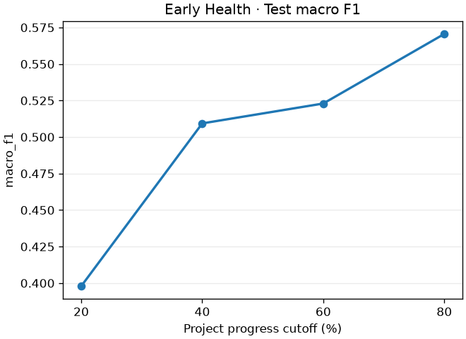

# 1. PRUNIN AI Core: informe final del Proyecto Aplicado III

**Portada textual.** Versión académica: 0.9.0-academic. Fecha de cierre: 11 de octubre de 2026. Repositorio: heiandavi-boop/tallerfina3. Audiencia: profesor/mentor, evaluador técnico y responsables de gestión de proyectos. Autor: completar con el nombre y datos institucionales antes de entregar; no se inventan identidades. HEAD main inicial auditado: b2d0ca32f0599fc6c2227f2a5eb3e6dea6ff812a. Métricas tomadas de reportes versionados; estado de checks en FINAL_READINESS.md.

## 2. Resumen ejecutivo

PRUNIN AI Core integra clasificación y regresión supervisadas con explicación generativa local para apoyar la gestión de riesgos de proyectos. La versión congelada `0.9.0-academic` se evalúa sobre un dataset sintético externo publicado en Mendeley Data. La meta original de detectar tempranamente al menos el 75 % de los proyectos críticos o en alto riesgo se formalizó sin reentrenar: la vista Risk Alert agrupa At Risk + Critical y, usando como denominador fijo los 473 proyectos TEST que finalmente pertenecen a esas clases, alcanza 75.90 % de detección al 60 % de avance con 96 % de cobertura TEST; al final alcanza 82.45 %. Health supera el baseline en Macro F1, Delay aporta una mejora marginal y Cost presenta desempeño interno alto condicionado por el generador EVM. Qwen3 8B fue evaluado en 30 casos con 29 respuestas aceptadas. Además, un benchmark operacional reproducible midió latencia, throughput y procesamiento individual/batch sobre 100 proyectos TEST. No está validado con proyectos empresariales reales; no se midió productividad humana ni carga productiva. El alcance defendible es un prototipo académico reproducible para entrega y sustentación.

## 3. Introducción

La gestión de proyectos requiere interpretar simultáneamente avance, cronograma y costos. PRUNIN propone convertir esas señales en estimaciones y recomendaciones revisables. Esta investigación aplicada separa la evaluación predictiva del apoyo textual y de las reglas operacionales, evitando atribuir a una capa resultados de otra.

El recorrido parte del contexto y la pregunta, delimita el alcance, describe método y presenta resultados antes de discutir eficiencia, riesgos y conclusiones.

## 4. Contexto empresarial

El usuario previsto es un director de proyecto o analista de una oficina de proyectos (PMO) que revisa snapshots de una cartera y decide dónde investigar desviaciones. PRUNIN propone apoyar esa revisión con señales de cronograma, costo y avance; detectar riesgo temprano permitiría preparar preguntas y acciones antes del cierre. No existe un piloto empresarial ni medición del retorno económico. Una predicción estima un outcome; una decisión combina evidencia del sistema, contexto contractual y criterio del responsable.

## 5. Problema

La interpretación manual de indicadores puede dificultar la priorización de proyectos y la comunicación del riesgo. Se aborda la necesidad de una herramienta trazable que produzca estimaciones consistentes y explicaciones fundamentadas. No se dispone de un estudio empresarial que cuantifique la frecuencia del problema ni su costo: se plantea como problema de diseño académico, sin inventar observaciones de producción.

## 6. Pregunta de investigación

¿En qué medida una arquitectura híbrida de inteligencia artificial, que combine modelos predictivos e IA generativa, permite detectar tempranamente riesgos de retraso y sobrecosto en proyectos y generar recomendaciones útiles para apoyar la toma de decisiones?

Se evalúa su componente predictivo y la generación estructurada sobre datos sintéticos; «recomendaciones útiles» es una finalidad cuya eficacia profesional requiere evaluación humana, no un resultado ya demostrado.

## 7. Objetivo general

Desarrollar y evaluar un prototipo reproducible de apoyo a la gestión capaz de anticipar riesgos de retraso y sobrecosto, detectar tempranamente proyectos críticos o en alto riesgo y traducir evidencia estructurada en recomendaciones trazables bajo supervisión humana. La meta operacional de la propuesta inicial es detectar al menos el 75 % de los proyectos Critical o At Risk.

## 8. Objetivos específicos

1. Preparar y verificar una fuente con procedencia y calidad explícitas.
2. Mantener partición disjunta por proyecto y evaluar modelos congelados frente a baselines TRAIN.
3. Caracterizar anticipación junto con cobertura temporal.
4. Integrar y evaluar generación local fundamentada, separada del predictor.
5. Documentar automatización, riesgos y trazabilidad reproducible.
6. Evaluar eficiencia operacional automatizada con latencia, throughput, escala local, éxito y robustez; dejar cualquier medición de usuarios como estudio futuro opcional.

## 9. Alcance

La entrega comprende un prototipo local: Health/Delay/Cost, Final Status derivado, Team Health heurístico, CSV, What-if y explicación Qwen opcional. Se conservan arquitectura, modelos, pesos, reglas y resultados del experimento 0.9.0-academic. No incluye nuevos modelos, infraestructura cloud, clúster activo ni validación empresarial. La documentación no equipara completitud del repositorio con acreditación automática de Nivel 4.

### Canales y medios para la audiencia

El informe se dirige al profesor/mentor y evaluador técnico, con una lectura empresarial centrada en decisiones de gestión. GitHub permite revisar código, versiones y CI; el informe desarrolla problema, metodología e interpretación; la presentación resume mensajes centrales; el Playground muestra comportamiento observable; JSON/CSV conservan evidencia exacta; figuras facilitan comparar resultados. La combinación sirve a reproducibilidad, profundidad académica y síntesis ejecutiva. No se sustituye el argumento por terminales ni JSON completo. La defensa usa glosario y preguntas documentadas, mientras voz y lenguaje no verbal requieren ensayo humano.

## 10. Arquitectura

React/Vite envía entradas validadas a FastAPI. `ModelRuntime` carga manifest, configuración y pipelines LightGBM. `PruninAcademicBrain` devuelve predicciones crudas y calcula reglas operativas independientes. El runtime añade la política de presentación de Delay. Los drivers se calculan mediante perturbaciones hacia referencias. Qwen3 8B, vía Ollama, recibe evidencia estructurada y explica; un validador acepta o rechaza su salida. El fallback determinístico conserva disponibilidad. `/api/ready`, `/api/monitoring` y `/metrics` aportan observabilidad local. Evidencia: `src/prunin_ai/api/`, `inference/brain.py` y `frontend/src/`.

**Figura 1. Arquitectura híbrida implementada.**

Fuente: implementación API/ML/GenAI actual. Los flujos de batch y What-if omiten Qwen. Ver diagramas de generación y pipeline en [arquitectura](architecture.md).

## 11. Datos

Mendeley v2 (DOI `10.17632/2p5sz57wh2.2`) es un dataset sintético externo publicado en Mendeley Data. El resumen preparado versionado contiene 4000 proyectos y 72549 snapshots. No son proyectos empresariales reales de PRUNIN. La referencia de Hajihoseyni (2026) documenta la simulación. Itemlet, Collaboration y SQuaD son fuentes independientes y no se unieron al entrenamiento académico. Evidencia: `dataset_summary.json` y `docs/datasets.md`.

## 12. Preparación de datos

El adaptador `data/adapters/mendeley_evm.py` estandariza columnas, unidades e identificadores. La auditoría revisa cobertura, duplicados, calidad y outliers IQR; el pipeline imputa numéricas por mediana y categóricas por moda aprendidas en TRAIN, y codifica categorías con OneHotEncoder. No se inventan variables ausentes. La normalización no es necesaria para particiones de árboles. Las siete features académicas tienen cobertura completa en el resumen versionado; el contrato API bloquea entradas con cobertura inferior a 60 %. Team Health no recibe imputación.

El split por `project_id` mantiene 2800 proyectos TRAIN, 600 VALIDATION y 600 TEST. Los snapshots de un proyecto permanecen juntos; `scripts/verify_split.py` comprueba conjuntos disjuntos. La whitelist excluye targets, costo y duración reales y outcomes finales. El ajuste del preprocesador usa TRAIN; la comparación de candidatos usa VALIDATION. TEST es evaluación descriptiva del candidato congelado. Esta separación evita leakage directo, pero no elimina la proximidad entre CPI/EVM tardío y outcome sintético. Evidencia: `split_summary.json`, manifest y reproducibility.

El preprocesamiento usa herramientas de scikit-learn (Scikit-learn developers, s. f.). El esquema Pydantic valida tipos, categorías y rangos; `true_progress` tolera únicamente ruido flotante ≤ 1e-9 en límites 0/1 y rechaza desviaciones reales. No se aplicó StandardScaler para cumplir una casilla: los árboles separan por umbrales y no requieren estandarización numérica. Sí existe estandarización semántica de nombres/unidades y normalización de progreso a su dominio. La detección IQR señala observaciones atípicas, sin eliminar automáticamente valores válidos ni cambiar el dataset. Hashes SHA256 y readiness permiten verificar procedencia e integridad. Inputs dentro de rango todavía pueden estar fuera de distribución: no existe un detector OOD productivo.

## 13. Modelos predictivos

Health es clasificación supervisada LightGBM; Delay y Cost son regresiones LightGBM. Se mantienen los artefactos y reglas de generación de etiquetas del experimento. Final Status deriva de Health: healthy → successful, at_risk → challenged, critical → critical; no es un cuarto modelo académico. Los baselines se ajustan sobre TRAIN: clase mayoritaria para Health y mediana por proyecto para regresión. Evidencia: `training/core.py`, `targets.py`, `baselines.json` y `feature_manifest.json`.

Las numéricas son `planned_duration_weeks`, `planned_budget`, `true_progress`, `spi`, `cpi`; las categóricas, `project_type` y `methodology`. Tipos: construction, healthcare, it, manufacturing, marketing, r&d. Metodologías: agile, hybrid, kanban, scrum, waterfall. Las variables futuras del catálogo no se presentan como features entrenadas. Los drivers son sensibilidad local ante sustitución por una referencia, no efectos causales.

Es una heurística operacional determinística, no un modelo supervisado ni indicador psicológico. Usa utilización, capacidad, productividad, retrabajo, defectos, estabilidad y colaboración disponibles. Requiere al menos tres componentes válidos y cobertura ponderada ≥ 0.5 según configuración existente. No imputa faltantes. En batch se oculta toda la columna si ninguna fila tiene score calculable; si alguna lo tiene, la columna aparece y las filas sin score siguen sin valor. La fusión 0.85 ML / 0.15 Team Health es heurística no calibrada con outcomes reales y se distingue del Health supervisado.

La elección de LightGBM responde al problema tabular y a la integración con pipelines reproducibles (Ke et al., 2017). Esta referencia describe el algoritmo, no prueba superioridad de PRUNIN frente a todos los modelos.

## 14. IA generativa

Qwen3 8B corre localmente mediante Ollama y convierte predicciones y drivers en explicación y recomendaciones. No predice Health, Delay ni Cost. CSV y What-if ejecutan ML sin generación; la generación opcional pertenece al análisis individual. El fallback `grounded_fallback` es determinístico y no se etiqueta como IA generativa.

Se conservó Qwen por ejecución local, soporte de español, tamaño y compatibilidad operativa con Ollama (Qwen Team, 2025). Gemma 3 4B y Ministral 3 8B se consideraron mediante documentación técnica oficial. No se ejecutó un benchmark comparativo PRUNIN entre los tres ni se afirma superioridad empírica de Qwen. El benchmark existente verifica únicamente Qwen en la configuración local usada.

El prompt restringe la respuesta a evidencia estructurada; el validador exige esquema JSON, features permitidas y ausencia de cifras nuevas no soportadas. Timeout, JSON inválido o evidencia no admitida activan fallback sin retirar la predicción ML. La trazabilidad distingue intento y uso GenAI, motor, error y tiempos. Groundedness es un proxy determinístico de ingeniería, no prueba de verdad semántica; una frase aceptada todavía puede ser incorrecta o poco útil. Se requiere revisión humana.

Comparación ampliada de idioma, licencia, hardware, contexto y compatibilidad: `docs/genai_model_selection.md`. Las fichas de Google DeepMind (s. f.-a, s. f.-b) y Mistral AI (s. f.-a, s. f.-b) permiten comparar alternativas documentalmente; no se instalaron ni evaluaron otros modelos en este cierre.

## 15. Automatización

Las tareas escogidas son interpretación de resultados, síntesis ejecutiva y redacción de recomendaciones: repetirlas sobre numerosos proyectos requiere leer señales y comunicarlas de manera consistente. La priorización combina drivers determinísticos y explicación; su utilidad profesional aún necesita revisión humana. El valor estratégico propuesto es apoyar al director y a la oficina de proyectos (PMO) al revisar y priorizar atención, sin delegar decisiones de presupuesto, cronograma o personas al sistema.

La generación beneficia especialmente la síntesis y la redacción. El procesamiento batch y las predicciones son automatización del API/ML, no automatización por Qwen. CSV admite hasta 100 filas; What-if compara escenarios sin LLM. El sistema produce recomendaciones y evidencia revisables; no demuestra reducción del tiempo humano hasta completar el protocolo de eficiencia.

## 16. Evaluación

La evaluación distingue tres niveles. Primero, los modelos congelados se comparan en TEST con baselines ajustados únicamente en TRAIN, separando métricas por snapshot y por proyecto. Segundo, los cortes de progreso estiman anticipación con una observación elegible por proyecto. Tercero, el benchmark generativo evalúa esquema, evidencia permitida, cifras no soportadas, acciones no vacías y latencia. No se usa TEST para escoger modelos ni se modifica la evidencia histórica.

La prueba manual adicional balanceada de 99 proyectos comunicada por el autor no tiene resultados estructurados versionados identificados. Se menciona como validación funcional manual, sin convertirla en métrica oficial. El test reproducible local de 99 filas valida cobertura y contrato, no el balance 33/33/33 ni exactitud predictiva. La métrica oficial usa 600 proyectos TEST.

Estos procedimientos responden a la pregunta de investigación dentro de un benchmark sintético. Las métricas generativas no demuestran recomendaciones útiles en empresas ni efectos causales; esa parte de la pregunta exige validación humana/prospectiva.

## 17. Resultados

### 17.1 Resultados predictivos

**Tabla 1. TEST por proyecto: modelo congelado frente a baseline aprendido en TRAIN.**

| Evaluación TEST project-level (600 proyectos) | Modelo | Baseline TRAIN |
|---|---:|---:|
| Health accuracy | 0.7266666667 | 0.7150000000 |
| Health balanced accuracy | 0.6824223458 | 0.3333333333 |
| Health Macro F1 | 0.6275758334 | 0.2779397473 |
| Health critical recall | 0.5681818182 | 0 |
| Delay MAE (días) | 27.7104683426 | 27.8503125000 |
| Cost MAE (puntos porcentuales) | 0.1471578505 | 5.0974437328 |
| Cost R² | 0.9918156959 | -0.0080230304 |

Fuente: `reports/0.9.0-academic/baselines.json`, coherente con `metrics.json`. Health TEST tiene 429 at_risk, 44 critical y 127 healthy. La accuracy del baseline 0.715 resulta del desbalance: siempre predice at_risk. Macro F1 promedia F1 de las tres clases con igual peso y permite ver esa limitación. Critical recall 0.568182 implica errores relevantes de detección; el prototipo requiere criterio humano. Las métricas project-level usan el snapshot más reciente de cada proyecto, no demuestran por sí solas predicción temprana.

Delay es el modelo predictivo más débil: MAE TEST 27.710468 días frente a 27.850313 del baseline, mejora marginal de 0.139844 días. Su R² es 0.075305. El experimento versionado eligió la mediana según VALIDATION y deshabilitó promoción automática; no sustituyó el artefacto LightGBM. No se usó TEST para elegir ni se reentrenó durante el cierre.

La predicción de regresión cruda puede ser ligeramente negativa. La interfaz aplica una restricción operacional de cero días para presentación, conservando el valor crudo en la trazabilidad técnica.

El API conserva `delay_days` numérico como `max(0, delay_days_raw)` y añade `delay_days_raw`. CSV y What-if comparten el runtime; sus diferencias operacionales usan el campo mostrado. Los reportes académicos conservan regresión cruda y no fueron reescritos. No se trunca Cost negativo, que puede representar ahorro.

Cost alcanza MAE project-level TEST 0.147158 puntos porcentuales (ratio 0.001471579) y R² 0.991816. El desempeño muy alto está relacionado en parte con la relación estructural entre CPI/EVM y el outcome de costo en el generador sintético. No demuestra precisión empresarial ni ausencia de errores fuera de esa distribución. El desempeño temprano es menor; deben leerse ambos resultados conjuntamente.

**Figura 2. Matriz de confusión Health, TEST por proyecto.**

Fuente: `health_confusion_matrix.csv` y figura versionada. Interpretación: detecta 25 de 44 proyectos critical; 13 se asignan a at_risk y 6 a healthy. Esos errores justifican supervisión humana y evitan considerar Health una decisión automática. La figura fue inspeccionada y coincide con el CSV; no se regeneró.

### 17.2 Resultados generativos

El reporte `reports/genai/qwen3-8b-evaluation.json` está `complete`, modelo `qwen3:8b`, artefacto `0.9.0-academic`, 30 casos evaluados. La unidad es el snapshot TEST más reciente con al menos un driver local de incremento de riesgo: una muestra condicionada, no todos los proyectos ni entradas arbitrarias.

**Tabla 2. Evaluación local de Qwen3 8B (30 casos).**

| Indicador | Valor observado |
|---|---:|
| generation_success_rate | 0.9666666667 |
| schema_valid_rate | 1.0000000000 |
| evidence_feature_valid_rate | 1.0000000000 |
| grounded_response_rate | 0.9666666667 |
| actionability_rate | 1.0000000000 |
| unsupported_numeric_claim_rate | 0.0333333333 |
| timeout_rate | 0.0000000000 |
| invalid_json_rate | 0.0000000000 |
| latency_ms_median | 3092.6450000000 |
| latency_ms_p95 | 6634.7200000000 |

29 de 30 respuestas fueron aceptadas y una introdujo una afirmación numérica no soportada. Schema y features válidas no garantizan aceptación: grounding aplica restricciones adicionales. Actionability comprueba acciones no vacías, no eficacia profesional. Mediana y p95 corresponden a este equipo y corrida, sin extrapolación a producción. El benchmark no se repitió ni se alteró durante este cierre.

El caso rechazado fue `mendeley::PROJ_0840`, clase critical, código `unsupported_numeric_claim`: el JSON y las features permitidas eran válidos, pero la respuesta incluyó cifras no admitidas por la evidencia. El guardrail detectó esa condición en lugar de aceptar texto convincente. Es una fortaleza de control, no prueba de que todas las alucinaciones semánticas sean detectadas; revisar lenguaje y pertinencia sigue siendo necesario.

### 17.3 Validación de la meta original de detección

La propuesta inicial estableció una meta operacional: **detectar tempranamente al menos el 75 % de los proyectos críticos o en alto riesgo**. Esa formulación corresponde a una alerta de negocio sobre dos clases, no al recall exclusivo de `Critical`. Por ello se agrega una métrica derivada, sin cambiar el modelo: Healthy = No Alert; At Risk o Critical = Risk Alert.

En TEST final existen 473 proyectos realmente At Risk/Critical. PRUNIN identifica 390 como At Risk/Critical: **Risk Alert Recall 82.45 %**, **Precision 92.20 %** y **F1 87.05 %**. La capacidad de distinguir específicamente la severidad Critical se conserva como métrica separada: recall 56.82 % (25/44).

Para evitar sesgo por cobertura temprana se usa además una métrica estricta de cohorte completa: TP dividido por los 473 proyectos que finalmente son At Risk/Critical. Un proyecto sin snapshot elegible en el corte cuenta como todavía no detectado. Con esta regla, la detección acumulada es 28.54 % al 20 %, 64.06 % al 40 %, **75.90 % al 60 %**, 79.92 % al 80 % y 82.45 % al final. El primer corte pre-cierre que supera la meta es 60 %, con 576/600 proyectos TEST cubiertos (96 %).

Esta métrica formaliza la promesa original; no reentrena, no cambia labels, thresholds ni TEST. Evidencia: `reports/promise_validation/` y `scripts/validate_original_promise.py`.

## 18. Evaluación temporal

La evaluación temporal se interpreta con dos denominadores. El **recall entre elegibles** mide desempeño dentro de proyectos que ya tienen snapshot antes del cutoff. La **detección de cohorte completa** usa como denominador fijo los 473 proyectos TEST que finalmente son At Risk/Critical y penaliza la falta de observación temprana.

| Avance | Cobertura TEST | Risk Recall entre elegibles | Detección de cohorte completa |
|---:|---:|---:|---:|
| 20 % | 39.33 % | 71.05 % | 28.54 % |
| 40 % | 77.17 % | 79.95 % | 64.06 % |
| 60 % | 96.00 % | 78.73 % | **75.90 %** |
| 80 % | 99.83 % | 79.92 % | 79.92 % |
| Final | 100 % | 82.45 % | 82.45 % |

El punto de cumplimiento experimental de la meta ≥75 % es el corte del **60 % de avance**, antes del cierre y con aproximadamente 40 % del ciclo todavía por ejecutar. Este hallazgo no convierte el benchmark sintético en validación empresarial.

**Tabla 3. Desempeño y cobertura por nivel de avance en TEST.**

| Avance máximo | Proyectos TEST | Cobertura | Health Macro F1 | Delay MAE días | Cost MAE pp |
|---|---:|---:|---:|---:|---:|
| 20 % | 236/600 | 39.333 % | 0.397938 | 33.146183 | 3.136943 |
| 40 % | 463/600 | 77.167 % | 0.509355 | 30.406823 | 2.789373 |
| 60 % | 576/600 | 96.000 % | 0.522959 | 28.305607 | 2.143231 |
| 80 % | 599/600 | 99.833 % | 0.570588 | 27.522773 | 1.406718 |

Fuente: `temporal_evaluation.csv/json`. Para cada cutoff se toma como máximo una observación por proyecto TEST, no posterior al avance indicado. En 20 % solamente 236 proyectos tienen observación elegible; la cobertura 39.333 % impide afirmar evaluación de los 600 en ese corte. Health mejora conforme avanza el proyecto, pero sigue limitado en anticipación. Los grupos de cobertura cambian: no es una trayectoria pareada completa de los mismos 600.

**Figura 3. Macro F1 Health por avance máximo elegible.**

Fuente: `reports/0.9.0-academic/temporal_evaluation.json`, cortes 0.2/0.4/0.6/0.8, y figura versionada. La curva sube con la maduración; la Tabla 3 evita ocultar que las coberturas cambian. No representa un panel completo pareado de 600 proyectos.

## 19. Eficiencia

Se ejecutó `scripts/benchmark_operational_efficiency.py` contra el API local que sirve `0.9.0-academic`, con GenAI apagada en ambos modos. El muestreo usa seed 42, el snapshot más reciente de 100 `project_id` del split TEST y solo las siete features; las mismas listas prefijo se comparan como N=1/10/25/50/100. Hubo tres warm-ups excluidos, 10 repeticiones para N=1/10/25 y cinco para N=50/100. Individual son N requests secuenciales a `/api/predict?include_recommendations=false`; batch es una llamada `/api/predict-csv`, también secuencial internamente. No se atribuye paralelización.

| N | Individual mediana | Batch mediana | Speedup batch/secuencial | Reducción temporal | Throughput batch |
|---:|---:|---:|---:|---:|---:|
| 1 | 45.84 ms | 46.61 ms | 0.983× | -1.68 % (batch más lento) | 21.454 proyectos/s |
| 10 | 454.24 ms | 426.40 ms | 1.065× | 6.13 % | 23.452 proyectos/s |
| 25 | 1138.24 ms | 1065.97 ms | 1.068× | 6.35 % | 23.453 proyectos/s |
| 50 | 2265.70 ms | 2116.37 ms | 1.071× | 6.59 % | 23.625 proyectos/s |
| 100 | 4440.90 ms | 4215.74 ms | 1.053× | 5.07 % | 23.721 proyectos/s |

Todas las ejecuciones normales tuvieron 100 % de éxito (80 runs raw: 40 por modo) y los mismos casos por N. Para N=100, el throughput batch derivado de la mediana es 1423.24 proyectos/min y el costo temporal mediano 42.16 ms/proyecto. La mediana individual secuencial fue 4440.90 ms frente a 4215.74 ms batch. La mejora medida es modesta y N=1 fue 1.68 % más lento en batch; se interpreta como reducción de overhead de endpoint/serialización para lotes N≥10, no como escalado paralelo. El aumento de N se comportó aproximadamente lineal respecto a la referencia local N=1.

La robustez se verificó fuera del throughput: fila con una feature faltante aceptada al 85.71 % y reportada como imputada por la política ML; cobertura inferior al 60 %, categoría inválida y `true_progress=1.2` rechazados; CSV inválido devuelto como error controlado por fila. Resultado 5/5 checks; cero timeouts/HTTP failures en la prueba normal. Una muestra GenAI separada de cinco casos tuvo 5/5 Qwen aceptados, mediana 1136.04 ms y p95 7314.038 ms; no se mezcló con la comparación ML/batch ni sustituyó el benchmark oficial de 30 casos.

El entorno fue macOS arm64, Python 3.12.15, API local, artifact 0.9.0-academic; el SHA de ejecución fue `e0beff14db7eab98f19c20ea90a3b3f7e4deea6b`. El API no expone workers, por lo que ese dato queda sin determinar. Estos resultados describen eficiencia operacional/capacidad del proceso automatizado en esta laptop. No demuestran productividad humana, ahorro laboral, producción, concurrencia ni rendimiento universal. Evidencia reproducible, datos crudos, casos, robustez, GenAI separada y gráficos: `reports/efficiency/`; método y comando: [protocolo](efficiency_evaluation.md).

## 20. Riesgos éticos

Se documentan privacidad, alucinaciones, sesgo de automatización, representatividad sintética, leakage, drift y falsa causalidad. Ollama local reduce transferencia a terceros, pero no reemplaza controles de acceso y retención. La supervisión humana es obligatoria para decisiones de impacto. Team Health no debe usarse para evaluar salud mental ni individuos. La validación real es necesaria antes de recomendaciones empresariales de alto impacto. Evidencia: `docs/ethics_security.md`.

La [matriz ética](ethics_security.md) distingue impactos, mitigaciones implementadas y límites: faltantes y OOD no equivalen, logging no reemplaza auditoría empresarial y local no equivale a control de acceso.

## 21. MLOps

La infraestructura académica incluye versionado, hashes SHA256, manifests, configuración resuelta, model card, CI, logs con prediction_id y endpoints de readiness/monitoring/métricas. Los contadores son en memoria por proceso. La política de actualización requiere datos aprobados, revisión de degradación y selección en VALIDATION. Prometheus centralizado, alertas reales, drift automático y retraining productivo continuo no están implementados como operación real.

Dockerfile empaqueta frontend y API usando lockfile. El manifiesto Kubernetes define Deployment con tres réplicas, RollingUpdate, probes, requests/limits, Service y HPA mínimo 3/máximo 10. Es diseño desplegable; no un clúster activo ni una prueba de producción. Requiere imagen con artefactos, dominio y recursos adecuados, metrics-server para HPA y observabilidad central antes de operar. No se montó infraestructura ni se afirmó throughput bajo carga.

The Kubernetes Authors (s. f.) documentan los mecanismos de despliegue utilizados conceptualmente; no es una evidencia de operación de PRUNIN. La política de retraining se activa con datos suficientes/aprobados y degradación o drift revisados; compara en VALIDATION y mantiene TEST congelado. El cierre no ejecutó retraining.

## 22. Limitaciones

Los datos son sintéticos; por tanto, el cumplimiento del KPI es experimental y no empresarial. El desbalance afecta Health, la detección exacta de Critical es incompleta, Delay apenas mejora la mediana y Cost depende del generador EVM. La evaluación temprana tiene cobertura desigual. La fusión no está calibrada; drivers no son causales. El benchmark GenAI es pequeño y condicionado; sus validadores son proxies. La eficiencia operacional se midió localmente, pero no hay baseline humano, validación empresarial ni clúster productivo. La prueba manual balanceada de 99 filas comunicada por el autor no tiene resultados estructurados versionados identificados: no se incorpora como métrica oficial. Existe un test local de 99 filas que verifica contrato y cobertura, sin balance 33/33/33 garantizado.

## 23. Conclusiones

La promesa principal se cumple **dentro del entorno experimental** cuando se mide de acuerdo con su formulación original: detectar proyectos Critical o At Risk. PRUNIN identifica 75.90 % de toda la cohorte TEST que finalmente queda en riesgo al 60 % de avance, con 96 % de cobertura; al final identifica 82.45 %. Esto no implica validación empresarial y no debe confundirse con el recall exacto de Critical, que es 56.82 %.

Health ofrece señal multiclase útil en este benchmark: Macro F1 0.627576 frente a 0.277940 del baseline, aunque solo recupera 25 de 44 critical. Delay es el componente predictivo más débil: mejorar MAE de 27.850313 a 27.710468 días no respalda una promesa de precisión alta. Cost funciona muy bien internamente (R² 0.991816), con dependencia estructural CPI/progreso–outcome que impide extrapolar el rendimiento empresarial.

El desempeño Health temprano mejora entre 20 y 80 % de avance, con cobertura de 236 a 599 proyectos; no demuestra anticipación universal. Qwen produjo explicaciones y recomendaciones estructuradas con 29 de 30 respuestas aceptadas, pero su utilidad profesional no está establecida. El rechazo de una cifra no soportada muestra por qué los guardrails son necesarios; grounding sigue siendo un proxy.

El aporte es una arquitectura que separa predicción, heurísticas y explicación con trazabilidad. La naturaleza sintética limita generalización; la eficiencia operacional local está cuantificada, pero no hay estudio controlado de usuarios ni validación prospectiva con proyectos reales. Se sostiene un prototipo académico reproducible para entrega y sustentación, no una solución productiva validada.

## 24. Trabajo futuro

Opcionalmente estudiar tiempos/calidad con usuarios bajo protocolo controlado; obtener proyectos reales con outcomes bajo acuerdos de datos; validar temporalmente y externamente; calibrar fusión; estudiar Delay usando TRAIN/VALIDATION sin escoger por TEST; desplegar observabilidad central y probar carga antes de escalar. Son tareas futuras, sin convertir métricas operacionales en productividad humana.

## 25. Referencias

Google DeepMind. (s. f.-a). *Gemma 3 4B IT* [Ficha de modelo]. Hugging Face. Recuperado el 11 de octubre de 2026, de https://huggingface.co/google/gemma-3-4b-it

Google DeepMind. (s. f.-b). *Gemma 3 model card*. Google AI for Developers. Recuperado el 11 de octubre de 2026, de https://ai.google.dev/gemma/docs/core/model_card_3

Hajihoseyni, R. (2026). *Simulated project risk and earned-value dataset: Project features, monthly PV/EV/AC time series and delay/cost outcomes* (Versión 2) [Conjunto de datos]. Mendeley Data. https://doi.org/10.17632/2p5sz57wh2.2

Ke, G., Meng, Q., Finley, T., Wang, T., Chen, W., Ma, W., Ye, Q., & Liu, T.-Y. (2017). LightGBM: A highly efficient gradient boosting decision tree. *Advances in Neural Information Processing Systems, 30*. https://papers.nips.cc/paper_files/paper/2017/hash/6449f44a102fde848669bdd9eb6b76fa-Abstract.html

Mistral AI. (s. f.-a). *Ministral 3 8B Instruct 2512* [Ficha de modelo]. Hugging Face. Recuperado el 11 de octubre de 2026, de https://huggingface.co/mistralai/Ministral-3-8B-Instruct-2512

Mistral AI. (s. f.-b). *Ministral 3 8B*. Mistral Docs. Recuperado el 11 de octubre de 2026, de https://docs.mistral.ai/models/ministral-3-8b-25-12

Qwen Team. (2025, 29 de abril). *Qwen3: Think deeper, act faster*. https://qwenlm.github.io/blog/qwen3/

Qwen. (s. f.). *Qwen3-8B* [Ficha de modelo]. Hugging Face. Recuperado el 11 de octubre de 2026, de https://huggingface.co/Qwen/Qwen3-8B

Scikit-learn developers. (s. f.). *About us*. Recuperado el 11 de octubre de 2026, de https://scikit-learn.org/stable/about.html

The Kubernetes Authors. (s. f.). *Deployments*. Recuperado el 11 de octubre de 2026, de https://kubernetes.io/docs/concepts/workloads/controllers/deployment/

Verificación bibliográfica y alcance: [referencias consolidadas](references.md). Evidencia propia: reports/0.9.0-academic/{dataset_summary,feature_manifest,metrics,baselines,temporal_evaluation,reproducibility}.json; reports/experiments/delay/comparison.json; reports/genai/qwen3-8b-evaluation.json. Citas homónimas de fichas/documentación viva se identifican también por título/enlace en la comparación GenAI; no se les inventa fecha editorial.
