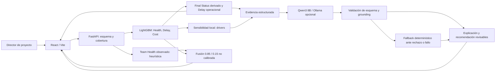
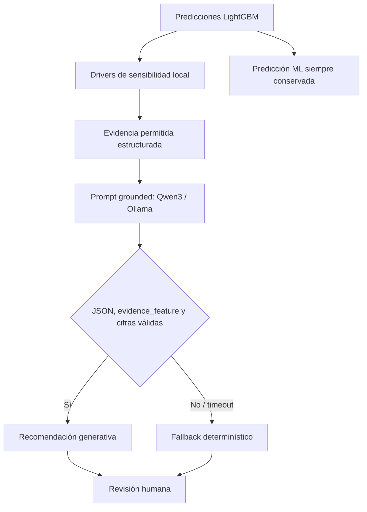

# Arquitectura académica implementada

El modelo congelado `0.9.0-academic` usa exclusivamente Mendeley v2, un dataset sintético externo publicado en Mendeley Data. Itemlet, Collaboration y SQuaD son fuentes independientes para trabajo futuro; no alimentan ni se unen al predictor académico actual.

## Figura A1. Flujo del Playground

Fuente: `src/prunin_ai/api/app.py`, `model_runtime.py`, `recommendations.py`, `inference/brain.py`, `features/team_health.py` y `frontend/src/`. Las flechas describen componentes implementados, no infraestructura empresarial activa. Health, Delay y Cost son ML; Final Status es derivado; Team Health y fusión son heurísticos. CSV y What-if no pasan por Qwen.

## Figura A2. Generación y guardrails

Fuente: `recommendations.py`, `tests/test_genai_grounding.py`. El prompt solicita JSON y limita evidence_feature a drivers permitidos; se validan cifras. Timeout configurable (30 s por defecto), códigos de error, `/api/genai-status` y flags genai_attempted/genai_used preservan trazabilidad. Un rechazo activa respaldo; no elimina la predicción ML. El grounding es proxy de ingeniería, no demostración de verdad semántica ni causalidad. La llamada local síncrona añade latencia al análisis individual; no se probó escalamiento de Qwen bajo concurrencia.

## Figura A3. Pipeline académico reproducible

```mermaid
flowchart LR
  D[Descarga] --> V[Validación raw]
  V --> P[Preparación]
  P --> A[Auditoría IQR y cobertura]
  A --> R[Readiness y hashes]
  R --> S[Split por proyecto y leakage]
  S --> T[Entrenamiento TRAIN]
  T --> E[Evaluación congelada y temporal]
  E --> B[Baselines TRAIN e informes]
  B --> F[Figuras]
  F --> C[Tests]
  C --> X[Preflight]
```

Fuente: `scripts/train_all.sh`, con `set -euo pipefail`, bloqueos explícitos ante fallo de datos y checks de artefactos. El baseline se ajusta con TRAIN; VALIDATION compara candidatos y TEST permanece evaluación final congelada. El script incluye además un experimento Delay sin promoción automática. El dibujo resume la secuencia; no implica que se reentrenara durante el cierre. Para reproducir, usar un checkout/entorno separado y conservar resultados oficiales.

## Entradas, artefactos y trazabilidad

Las siete features académicas se registran en `reports/0.9.0-academic/feature_manifest.json`. No se imputan señales Team Health. Delay raw permanece en `delay_days_raw`; API/CSV/What-if presentan `delay_days=max(0, raw)`. Cost negativo conserva ahorro. Final Status mapea healthy→successful, at_risk→challenged, critical→critical.

El artefacto local incluye tres .joblib, feature_manifest, split_manifest, configuración resuelta, métricas, baselines y hashes. Los modelos pesados y datasets no están versionados en Git; los reportes ligeros sí. Un clon puede ejecutar CI con fixtures demo, pero la sustentación académica exige los artefactos oficiales locales.

Versiones antiguas retiraron reported_progress, critical_path_delay_days y team_morale. No se reintroducen como features actuales. El modo demo puede conservar Final Status independiente por su fixture; no debe confundirse con el contrato académico derivado.
