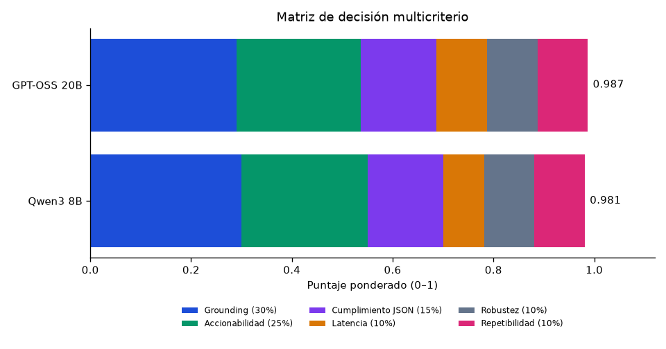

# Selección del modelo generativo local — PRUNIN AI Core

## Decisión implementada
La versión académica utiliza **Ollama con Qwen3 8B** para convertir evidencia estructurada de proyectos en acciones trazables. Esta elección está alineada con privacidad de los indicadores, ejecución sin servicio de inferencia externo, control de versiones por digest, disponibilidad en el hardware de demostración y capacidad de respuesta estructurada en español. No representa una afirmación de superioridad universal.

La arquitectura separa los tres modelos LightGBM congelados (Health, Delay, Cost) de la capa generativa. Qwen no calcula las predicciones ni reemplaza la revisión profesional. El motor genera máximo cuatro acciones con evidencia verificable y seguimiento, y el validador puede rechazar la generación y ofrecer respaldo determinístico.

## Alternativas locales comparadas

| Candidato local | Arquitectura | Estado en PRUNIN |
|---|---|---|
| Qwen3 8B (`500a1f067a9f`, Q4_K_M) | Transformer denso, 8,2 B parámetros, razonamiento desactivable | Modelo de producción; medido en la comparación 2026 |
| GPT-OSS 20B (`17052f91a42e`, MXFP4) | Mezcla de expertos, 20,9 B totales, 4 de 32 expertos activos por token, razonamiento obligatorio | Medido en la comparación 2026 bajo las mismas condiciones |
| Gemma 3 / Ministral 3 | — | Fuera de alcance por decisión del proyecto; sin mediciones ni rendimiento atribuido |

## Comparación experimental Qwen3 8B vs. GPT-OSS 20B (noviembre de 2026)

Comando reproducible (no descarga modelos, no sobrescribe un experimento completo y reanuda corridas interrumpidas con verificación SHA-256 por fila):

```bash
PYTHONPATH=src python scripts/run_local_model_comparison.py \
  --models qwen3:8b gpt-oss:20b --cases 30 --repeats 3 \
  --output-dir reports/genai/qwen_vs_gptoss_2026
```

Ambos modelos recibieron los mismos 30 casos TEST (sin solape con TRAIN/VALIDATION), el mismo prompt, esquema JSON, validador, temperatura 0,1, `num_predict` 1200 y hardware (Apple M5 Pro, 24 GB), con ejecución secuencial, warm-up excluido y 5 casos × 3 repeticiones por modelo. Diferencia registrada: GPT-OSS no admite `think=false` (devuelve contenido vacío), por lo que se usó su nivel mínimo `low`.

| Indicador (automático) | Qwen3 8B | GPT-OSS 20B |
|---|---:|---:|
| Aceptadas / JSON válido / esquema | 30/30 · 100 % · 100 % | 29/30 · 100 % · 100 % |
| Cifras no soportadas / contradicciones / timeouts | 0 / 0 / 0 | 0 / 0 / 0 |
| Motivo de rechazo | — | 1 × `invalid_evidence_provenance` |
| Latencia media / mediana / p95 (ms) | 10938 / 8588 / 20974 | 7595 / 6973 / 10575 |
| Tokens generados por segundo | 23,1 | 30,9 |
| Memoria residente (`/api/ps`) | 5,5 GB | 11,9 GB |
| Repetibilidad: casos consistentes / respuestas idénticas | 100 % / 80 % | 100 % / 20 % |

**Matriz ponderada** (grounding 30 %, accionabilidad 25 %, JSON 15 %, latencia 10 %, robustez 10 %, repetibilidad 10 %): Qwen3 8B **0,981**, GPT-OSS 20B **0,987**. La diferencia (0,006) es menor que el margen defendible de 0,03 y el orden se invierte al eliminar la latencia o reducir su peso a la mitad; McNemar exacto sobre aceptación pareada: p = 1,0. **No se declara un ganador defendible.**



Evidencia completa: [informe](../reports/genai/qwen_vs_gptoss_2026/comparison_report.md), [análisis crítico](../reports/genai/qwen_vs_gptoss_2026/critical_analysis.md), [conclusiones](../reports/genai/qwen_vs_gptoss_2026/conclusions.md), [datos crudos](../reports/genai/qwen_vs_gptoss_2026/benchmark_raw.csv) y [manifiesto](../reports/genai/qwen_vs_gptoss_2026/execution_manifest.json).

## Evidencia existente

**Evaluación histórica académica congelada:** Qwen3 8B produjo 29/30 recomendaciones aceptadas, una cifra no soportada, mediana 3092.645 ms y p95 6634.72 ms. Se conserva en `reports/genai/qwen3-8b-evaluation.json`.

**Ejecución experimental adicional:** Qwen3 8B, digest `500a1f067a9f`, cuantización Q4_K_M, produjo 30/30 respuestas aceptadas en los 30 casos controlados y 30/30 en el modo operativo local. Latencia mediana 8114.68 ms (p95 19783.22 ms) y 8305.3 ms (p95 18347.63 ms), respectivamente; cinco casos repetidos tres veces mantuvieron la estructura y las acciones. Esta ejecución fue distinta de la evaluación histórica y no sustituye sus métricas.

**Benchmark de candidatos locales:** Qwen3 8B produjo 29/30 aceptaciones en un experimento adicional, mientras que los otros candidatos de ese experimento no estuvieron disponibles. Consultar `reports/genai/comparison/` para el detalle real de esa corrida.

## Matriz cualitativa de restricciones (Qwen3 8B)

| Criterio | Valor y limitación de Qwen3 8B |
|---|---|
| Privacidad | Inferencia de recomendaciones dentro del entorno local, si Ollama se configura en una red confiable |
| Conectividad | No necesita un servicio remoto de inferencia; sí requiere que Ollama esté operativo |
| Recursos | El modelo cuantizado requiere memoria y capacidad de cómputo; el rendimiento depende del equipo |
| Costos | No hay cargo externo por tokens, pero existen costos computacionales |
| Calidad | Se cumplen los controles proxy en las pruebas reportadas; falta evaluación humana ciega |
| Reproducibilidad | Digest de modelo y parámetros documentados; los resultados varían con el entorno |
| Riesgo operacional | Latencia y timeouts aumentan bajo concurrencia; usar fallback determinístico |

**Conclusión:** la comparación medida muestra un empate técnico: GPT-OSS 20B es más rápido (mediana −19 %, p95 −50 %) y Qwen3 8B no tuvo rechazos y usa menos de la mitad de memoria residente. Con esa evidencia, PRUNIN **mantiene Qwen3 8B** como modelo configurado por continuidad, cero rechazos en el contrato de evidencia y menor huella en un equipo de 24 GB; no es una afirmación de superioridad. GPT-OSS 20B es una alternativa viable si la latencia pasa a ser prioritaria y hay memoria disponible. La comparación cubre dos alternativas locales y la calidad semántica humana sigue pendiente. La rúbrica no exige un proveedor de nube.

Los 75 intentos locales originales y sus entradas, métricas y manifiesto están disponibles en [la evidencia Qwen local](../reports/genai/qwen_local_2026/README.md).
