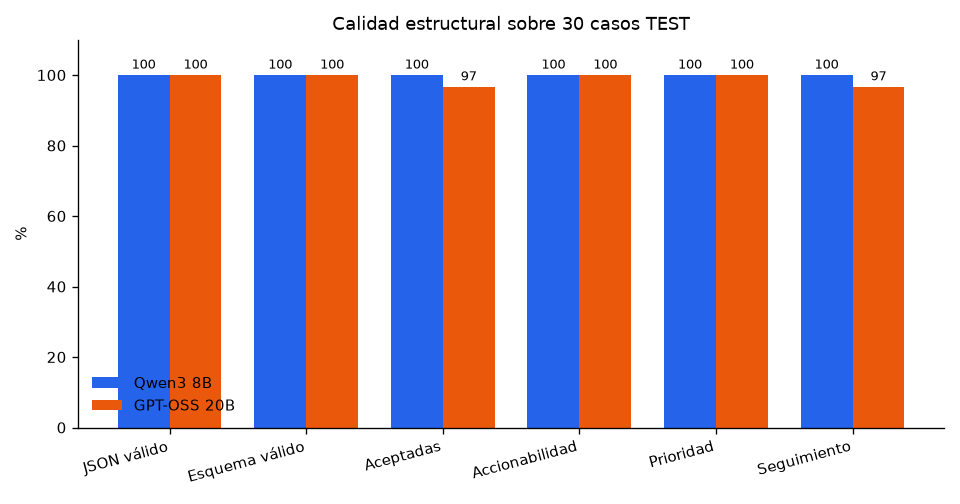
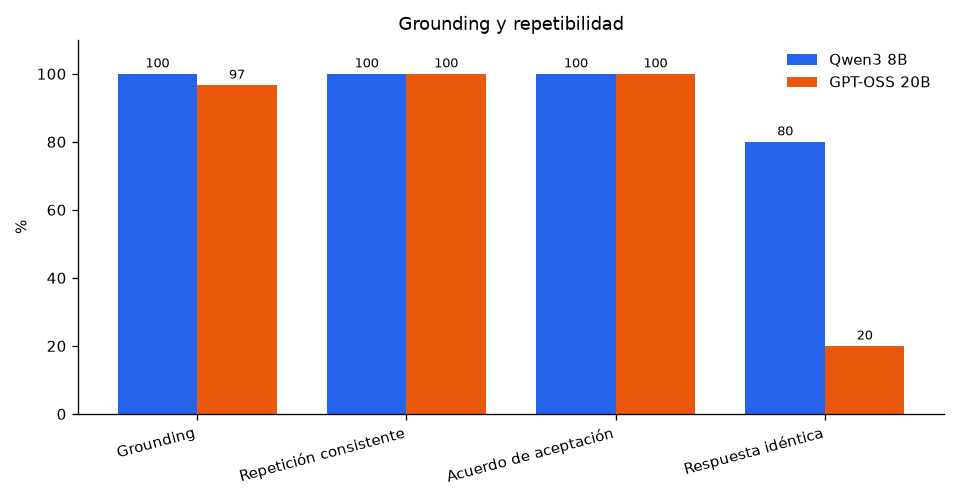
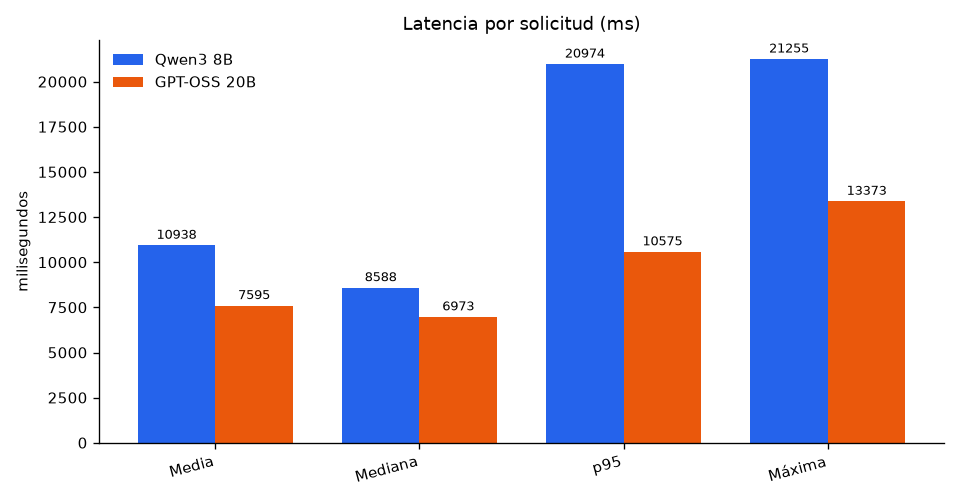
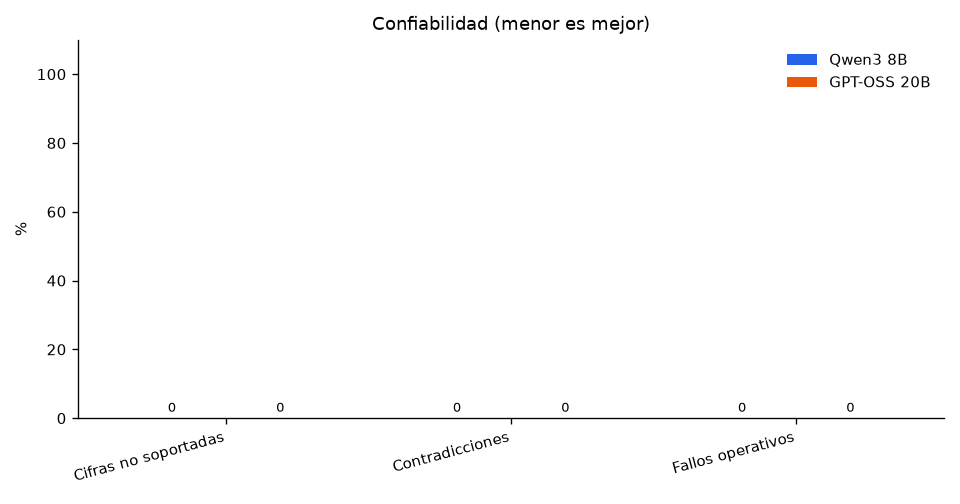
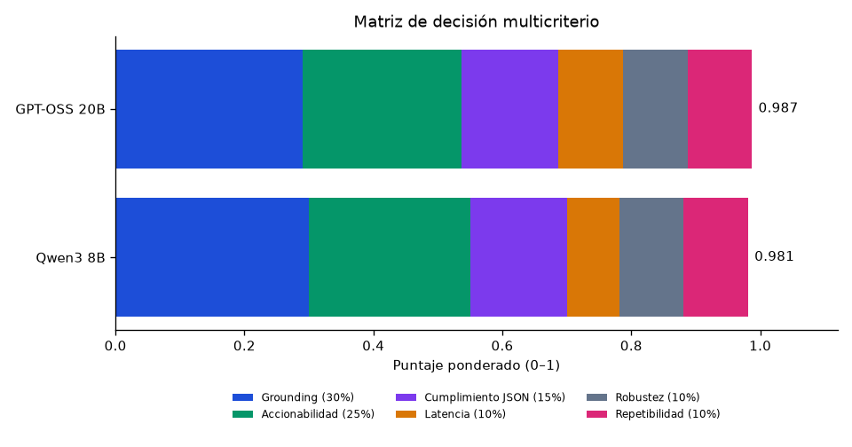

# Comparación experimental local: Qwen3 8B vs. GPT-OSS 20B

Experimento `qwen_vs_gptoss_2026` · inicio 2026-11-19T04:20:29+00:00 · fin 2026-11-19T04:34:58+00:00 · Ollama 0.33.2.

Todas las cifras provienen de `benchmark_raw.csv` (inferencias reales registradas en `runs.jsonl` con huella SHA-256 por fila). Son **indicadores automáticos** del validador determinista de PRUNIN; **no** hubo evaluación semántica humana.

## 1. Por qué Qwen3 8B y GPT-OSS 20B

Son los dos modelos generativos abiertos instalados localmente que cumplen las restricciones de PRUNIN: ejecución sin servicios externos (privacidad de datos de proyecto), licencia Apache 2.0, salida JSON restringida por esquema en Ollama y tamaño compatible con un portátil de 24 GB. Representan dos diseños distintos —denso de 8B frente a mezcla de expertos de 21B— lo que amplía la búsqueda más allá de variantes del mismo modelo. Gemma y servicios en la nube quedaron fuera de alcance por decisión del proyecto.

## 2. Arquitectura y diferencias relevantes

- **Qwen3 8B**: transformer denso (~8,2 B parámetros, todos activos por token) con modo de razonamiento híbrido que puede desactivarse. Es el modelo de producción de PRUNIN.
- **GPT-OSS 20B**: transformer de mezcla de expertos (~21 B parámetros totales, ~3,6 B activos por token según la ficha pública de OpenAI), pesos MXFP4 y razonamiento obligatorio con niveles `low/medium/high`.

| Atributo | Qwen3 8B | GPT-OSS 20B |
|---|---|---|
| Identificador Ollama | qwen3:8b | gpt-oss:20b |
| Digest | `500a1f067a9f` | `17052f91a42e` |
| Familia | qwen3 | gptoss |
| Arquitectura (GGUF) | qwen3 | gptoss |
| Parámetros | 8.2B | 20.9B |
| Cuantización | Q4_K_M | MXFP4 |
| Tamaño en disco (bytes) | 5225388164 | 13793441244 |
| Contexto máximo | 40960 | 131072 |
| Expertos (MoE) | n/a | 32 |
| Expertos activos por token | n/a | 4 |
| Razonamiento (`think`) | `False` | `low` |
| Memoria residente medida (`/api/ps`) | 5919872122 bytes | 12728076860 bytes |

## 3. Metodología experimental

- **Casos**: los mismos 30 proyectos TEST (último snapshot con al menos un driver de riesgo; `random_state=42`), verificados contra `split_manifest.json` sin solape con TRAIN ni VALIDATION.
- **Entrada idéntica**: misma predicción LightGBM congelada, drivers, contexto de evidencia, prompt (`build_grounded_prompt`), esquema JSON forzado y validador (`validate_generated_payload`). Las huellas `evidence_sha256` y `prompt_sha256` de cada caso son iguales para ambos modelos.
- **Parámetros**: temperatura 0.1, `num_predict` 1200, timeout 180.0 s, `stream=false`.
- **Ejecución**: secuencial; antes de cada modelo se descargan los modelos residentes y se realiza un warm-up excluido de las métricas.
- **Repetibilidad**: casos `mendeley::PROJ_0953`, `mendeley::PROJ_3737`, `mendeley::PROJ_0840`, `mendeley::PROJ_0556`, `mendeley::PROJ_1238` (selección determinística por SHA-256), 3 repeticiones por modelo.
- **Diferencias de configuración registradas**:
- `think`: Qwen3 8B=False, GPT-OSS 20B=low. GPT-OSS no permite desactivar el razonamiento: con think=false Ollama devuelve contenido vacío. Se usa el nivel mínimo admitido (low).
- `num_predict`: Qwen3 8B=1200, GPT-OSS 20B=1200. Mismo presupuesto; en GPT-OSS incluye los tokens de razonamiento, lo que reduce el margen de salida visible.
- `tokenizer`: Qwen3 8B=propio, GPT-OSS 20B=propio. El mismo prompt produce distinto número de tokens de entrada; los tokens/s no son directamente equivalentes.
- `prompt`: Qwen3 8B=idéntico (incluye la directiva /no_think de Qwen), GPT-OSS 20B=idéntico (incluye la directiva /no_think de Qwen). No se adapta el prompt por modelo para preservar la igualdad de condiciones.

## 4. Condiciones de hardware

Apple M5 Pro · 24.0 GB de memoria unificada · macOS-27.2.1-arm64-arm-64bit · Python 3.12.15. La memoria residente se midió con `/api/ps` de Ollama; no se midió CPU/GPU del sistema operativo.

## 5. Resultados individuales y comparativos

| Categoría | Métrica | Qwen3 8B | GPT-OSS 20B |
|---|---|---:|---:|
| Calidad | Respuestas aceptadas | 100.0 % | 96.7 % |
| Calidad | JSON válido | 100.0 % | 100.0 % |
| Calidad | Esquema válido | 100.0 % | 100.0 % |
| Calidad | Grounding | 100.0 % | 96.7 % |
| Confiabilidad | Alucinaciones numéricas | 0.0 % | 0.0 % |
| Confiabilidad | Contradicciones | 0.0 % | 0.0 % |
| Confiabilidad | Respuestas rechazadas (de 30) | 0 | 1 |
| Recomendaciones | Accionabilidad | 100.0 % | 100.0 % |
| Recomendaciones | Prioridad válida y ordenada | 100.0 % | 100.0 % |
| Recomendaciones | Seguimiento verificable | 100.0 % | 96.7 % |
| Rendimiento | Latencia media (ms) | 10938 | 7595 |
| Rendimiento | Latencia mediana (ms) | 8588 | 6973 |
| Rendimiento | Latencia p95 (ms) | 20974 | 10575 |
| Rendimiento | Tokens generados por segundo | 23.1 | 30.9 |
| Rendimiento | Tokens generados por respuesta | 211.0 | 144.7 |
| Rendimiento | Caracteres de razonamiento por respuesta | 0.0 | 77.9 |
| Estabilidad | Timeouts (principal + repetición) | 0 | 0 |
| Estabilidad | Tasa de fallos operativos | 0.0 % | 0.0 % |
| Estabilidad | Casos repetidos consistentes | 100.0 % | 100.0 % |
| Estabilidad | Acuerdo de aceptación entre repeticiones | 100.0 % | 100.0 % |
| Estabilidad | Respuestas idénticas entre repeticiones | 80.0 % | 20.0 % |

Motivos de rechazo en la corrida principal:

- **Qwen3 8B**: ninguno.
- **GPT-OSS 20B**: `invalid_evidence_provenance` × 1.

Prueba de McNemar exacta sobre la aceptación pareada de los 30 casos: 1 caso aceptado solo por Qwen3 8B y 0 casos solo por GPT-OSS 20B; p = 1.0000. Con 30 casos la diferencia de aceptación no es estadísticamente significativa (α = 0,05); el resultado debe leerse como evidencia direccional.

## 6. Matriz de decisión

| Criterio | Peso | Qwen3 8B (normalizado / ponderado) | GPT-OSS 20B (normalizado / ponderado) |
|---|---:|---:|---:|
| Grounding | 30% | 1.000 / 0.300 | 0.967 / 0.290 |
| Accionabilidad | 25% | 1.000 / 0.250 | 0.989 / 0.247 |
| Cumplimiento JSON | 15% | 1.000 / 0.150 | 1.000 / 0.150 |
| Latencia | 10% | 0.812 / 0.081 | 1.000 / 0.100 |
| Robustez | 10% | 1.000 / 0.100 | 1.000 / 0.100 |
| Repetibilidad | 10% | 1.000 / 0.100 | 1.000 / 0.100 |
| **Total** | **100 %** | **0.981** | **0.987** |

Normalización: **Grounding**: Tasa de respuestas aceptadas por el validador (grounded_rate). **Accionabilidad**: Media de actionability_rate, priority_valid_rate y follow_up_verifiable_rate. **Cumplimiento JSON**: Media de json_valid_rate y schema_valid_rate. **Latencia**: Mediana más rápida / mediana del modelo (1.0 = más rápido). **Robustez**: 1 − tasa de fallos operativos (timeout, indisponibilidad, HTTP) en corridas principal y de repetición. **Repetibilidad**: Proporción de casos repetidos con igual aceptación, señales citadas y prioridades en todas las repeticiones.

### Análisis de sensibilidad

| Escenario | Qwen3 8B | GPT-OSS 20B | Mejor |
|---|---:|---:|---|
| base | 0.981 | 0.987 | GPT-OSS 20B |
| pesos_iguales | 0.969 | 0.993 | GPT-OSS 20B |
| sin_latencia | 1.000 | 0.986 | Qwen3 8B |
| latencia_x2 | 0.966 | 0.988 | GPT-OSS 20B |
| grounding_+50% | 0.984 | 0.985 | GPT-OSS 20B |
| grounding_-50% | 0.978 | 0.991 | GPT-OSS 20B |
| actionability_+50% | 0.983 | 0.987 | GPT-OSS 20B |
| actionability_-50% | 0.979 | 0.987 | GPT-OSS 20B |
| json_compliance_+50% | 0.983 | 0.988 | GPT-OSS 20B |
| json_compliance_-50% | 0.980 | 0.986 | GPT-OSS 20B |
| latency_+50% | 0.973 | 0.988 | GPT-OSS 20B |
| latency_-50% | 0.990 | 0.987 | Qwen3 8B |
| robustness_+50% | 0.982 | 0.988 | GPT-OSS 20B |
| robustness_-50% | 0.980 | 0.987 | GPT-OSS 20B |
| repeatability_+50% | 0.982 | 0.988 | GPT-OSS 20B |
| repeatability_-50% | 0.980 | 0.987 | GPT-OSS 20B |

## 7. Fortalezas, limitaciones y justificación para PRUNIN

- **Qwen3 8B** — supera en: Grounding, Accionabilidad; queda por debajo en: Latencia.
- **GPT-OSS 20B** — supera en: Latencia; queda por debajo en: Grounding, Accionabilidad.

La matriz **no declara un ganador defendible**: La diferencia ponderada (0.006) es menor que el margen defendible (0.03). El ganador cambia en el análisis de sensibilidad: sin_latencia, latency_-50%.

Capacidad de ejecución local (fuera de la matriz, medida con `/api/ps`): Qwen3 8B: 5.5 GB residentes, mediana 8.6 s, aceptación 100.0 %; GPT-OSS 20B: 11.9 GB residentes, mediana 7.0 s, aceptación 96.7 %. En un equipo de 24 GB la memoria residente condiciona la convivencia con el navegador, el backend y otros procesos.

El modelo configurado en la aplicación **no se cambia automáticamente**; Qwen3 8B permanece como predeterminado hasta una decisión explícita del equipo.

Ver `critical_analysis.md` (riesgos y amenazas a la validez) y `conclusions.md` (conclusiones frente a R6.1-Cr2 y R6.1-Cr4).
